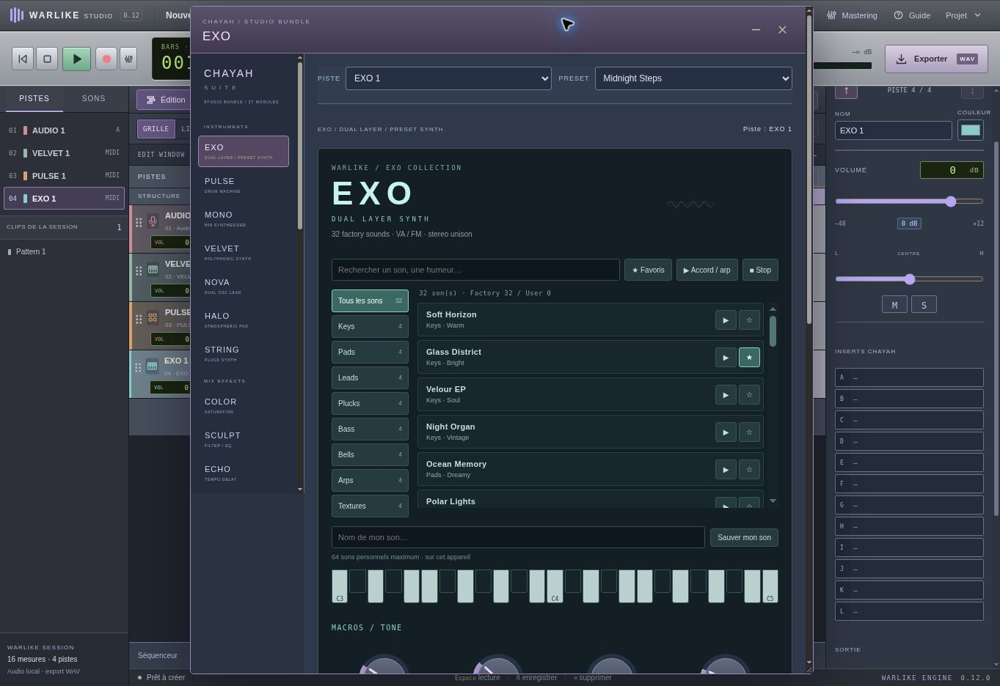

# Warlike Studio + CHAYAH Suite

## R08.3g.6 — Organisation des presets

Le mode **Presets** du sélecteur d'instrument ou d'insert classe les sons par **source → collection → famille → plugin → genre**. Chaque fenêtre propose aussi **Parcourir les presets**, avec recherche et sources **Usine / Projet / Cet appareil**, sans changer les indices ni les valeurs des banques. Les commandes de gestion restent dans **Mes presets et racks**. [Fonctionnement et validation](docs/preset-folders.md).

## R08.3g.3 — Commandes communes des plugins

Les fenêtres de pistes réunissent en haut l'identification piste/insert, les presets, le bypass et A/B pour les effets, ainsi qu'un historique Annuler/Rétablir propre au plugin. **Plus** regroupe Reset et les commandes secondaires ; les banques personnelles et les racks restent accessibles dans un panneau repliable. Les habillages CSS/SVG de chaque processeur sont conservés. [Fonctionnement et limites](docs/plugin-command-bar.md). Validation Chromium requise avant fusion.

## Démos : piano Drill conservé, deux Trap Atlanta et Funk brésilien

Dans **Projet → Mes projets**, ouvrir une nouvelle copie des arrangements révision 3. Chaque session a 16 mesures, des pistes modifiables et trois pistes vides pour enregistrer la voix.

| Démo | Tempo | Direction |
| --- | --- | --- |
| Drill nocturne | 142 BPM · Fa mineur | Notes et départ du piano conservés ; voicings de soutien, réponses dans les silences, piano plus présent et espace discret |
| Atlanta After Dark | 140 BPM · Do mineur | Piano mineur, texture sombre en retrait, 808 lourde, kick/snare espacés et fins de phrase en triolets |
| Atlanta Floating | 146 BPM · Si mineur | Boucle de guitare, harmonies ouvertes, réponses de flûte parcimonieuses et 808 mélodique |
| Baile Tamborzão | 130 BPM · Fa mineur | Percussions entrelacées de toms, congas et slaps, sub court et hook synthétique minimal |

Accès direct après déploiement : [`?demo=drill`](https://warlike-studio.pages.dev/?demo=drill), [`?demo=trap808`](https://warlike-studio.pages.dev/?demo=trap808), [`?demo=trap-air`](https://warlike-studio.pages.dev/?demo=trap-air), [`?demo=funk`](https://warlike-studio.pages.dev/?demo=funk). Les références demandées pour les deux directions Atlanta sont Metro/Future et Young Thug/Gunna ; les partitions sont originales et n’utilisent pas leurs enregistrements ou leurs mélodies. Le funk demandé est brésilien. La session `funk` utilise donc maintenant une direction baile, avec quatre pistes instrumentales ciblées plutôt que l’ancienne orchestration de funk classique.

La fixture `tests/fixtures/drill-v2-piano.json` conserve les notes du piano précédent. Les tests vérifient qu’elles figurent toutes dans la version enrichie et que la première mesure reste identique en MIDI. Le volume et les effets d’espace évoluent pour donner de la profondeur. Les autres partitions de la drill sont conservées.

Les glissés 808 sont des intervalles relatifs par note (`slide` en demi-tons). Dans le Piano Roll de MONO, sélectionner les notes puis **Glissé 808** pour les modifier ou les retirer. Les notes sans `slide` conservent leur rendu. Les triolets Atlanta utilisent deux phases de clips de percussion (un tiers et deux tiers de pas), partagées par la lecture, le fichier `.chayah` et le WAV.

PULSE propose le **kit 4 Baile**, synthèse originale de membranes et de slaps. Il ne charge pas de samples de batterie acoustique et ne contient pas de ROM Roland. Les kits 1–3 conservent leurs banques enregistrées. Voir [les choix de rythme et références](docs/beat-demo-directions.md).

Le workflow qualité rend les quatre sessions complètes dans Chromium, contrôle les sections, le grave et le WAV 24 bits, mesure un glissé réel de 55 à 110 Hz et les huit voix du kit Baile, puis vérifie sauvegarde/import/réouverture. Rapport et captures dans `studio-beat-demos`. Ces tests vérifient le fonctionnement audio ; l’appréciation du morceau et de sa direction reste une écoute musicale.

## Studio Cloud — sauvegarde et changement de compte

Les envois et téléchargements cloud vérifient le compte attendu à partir de la session authentifiée de Server. Un remplacement du cookie dans un autre onglet interrompt les envois de l’ancien compte. Les écritures transmettent l’origine interne requise par Server et les corps sont bornés pendant leur lecture. Un premier transfert audio incomplet reste identifiable et ne peut pas être restauré comme une sauvegarde terminée.

La bibliothèque affiche le compte cloud connecté et conserve les projets locaux en cas d’erreur. Le stockage local du même profil navigateur demeure partagé et non chiffré. Voir [le contrat et les limites de validation](docs/studio-cloud-account-safety.md) et le workflow de connexion native, D1/R2 et restauration audio dans Chromium.


## Nouvelle collection : WL HERITAGE, sept guitares et trois synthétiseurs

**Produits WarLike originaux** inspirés des usages de studio analogique, des guitares virtuelles articulées et des synthétiseurs à presets. Aucun sample, algorithme, interface ou préréglage propriétaire d'Abbey Road, Ample Sound, reFX Nexus, LennarDigital Sylenth1 ou Spectrasonics Omnisphere n'est fourni ou reproduit.

### WL HERITAGE ROOMS — console / espace / coloration

Ce bundle est une **collection de vrais effets existants de WarLike**, accessible par les chaînes FX natives : *WL Heritage / Studio Tracking*, *WL Heritage / Live Room* et *WL Heritage / Mix Bus*. Les chaînes sont composées de CIRCUIT EQ, CIRCUIT COLOR, CIRCUIT BUS, VOX AMBIENCE, ALTER ECHO et VECTOR LIMIT selon le preset. Leurs processeurs utilisent les nœuds Web Audio de Studio : ce ne sont pas des copies de modules Abbey Road.

### WL GUITAR COLLECTION — sept instruments différents

| Instrument | Identifiant | Génération audio |
| --- | --- | --- |
| WL STEEL 6 | `wlsteel` | Cordes acier physiques, attaque et résonance |
| WL NYLON | `wlnylon` | Cordes nylon adoucies et corps acoustique |
| WL FOLK 12 | `wlfolk12` | Douze cordes simulées par doublage et octaves |
| WL JAZZ HOLLOW | `wljazz` | Guitare jazz à caisse creuse et filtrage tonal |
| WL CLEAN SINGLE | `wlclean` | Guitare électrique claire, timbre brillant |
| WL CRUNCH | `wlcrunch` | Cordes électriques et saturation waveshaper 4× |
| WL MUTED FUNK | `wlmuted` | Résonance étouffée, jeu rythmique court |

Les guitares génèrent réellement des sons à partir d'un **modèle simplifié de corde Karplus–Strong** et de circuits de filtre/saturation selon la guitare. Elles ne comprennent pas encore des banques d'enregistrements multicouches, techniques de frettes sophistiquées, hammer-ons/pull-offs, ni le réalisme intégral d'une bibliothèque Ample Sound. Trois presets originaux par instrument sont inclus.

### Synthèse : trois moteurs réellement distincts

| Pack | Instrument | Architecture |
| --- | --- | --- |
| WL ATLAS | `wlrompler` | Synthé multicouche à deux oscillateurs et sélection de formes d'onde, conçu pour les presets rapides |
| WL VANGUARD | `wlvirtual` | Analogique virtuel à oscillateurs désaccordés, filtre et enveloppe |
| WL NEBULA | `wlspectral` | FM/modulation de fréquence et harmoniques, avec contrôle des textures |

Chacun possède ses paramètres propres et trois presets. **WL ATLAS est actuellement un synthétiseur à couches, pas un lecteur de ROM de samples** ; WL NEBULA n'est pas encore un synthétiseur spectral FFT/granulaire. Les trois déclenchent de véritables sources Web Audio et sont disponibles comme instruments dans les projets.

**Démos inchangées :** `nocturne` (Trap), `soleil` (Afro) et `brume` (R&B) continuent d'utiliser leurs instruments et arrangements originaux. Aucune des nouvelles guitares ou synthèses n'est automatiquement ajoutée aux démos. Tests Node pour le registre, les presets, la création des voix et l'absence de contamination des démos ; rendu acoustique en navigateur et écoute humaine restent à confirmer.

---

## Démos Rock, Pop et Rumba — voix, mix et mastering WarLike

Les trois démos utilisent les **kits de batterie enregistrés** propres au style (Rock = kit 1, Pop = kit 2, Rumba = kit 3), des instruments WarLike arrangés et des **pistes de voix synthétiques réellement audibles** : `DEMO VOICE · LEAD`, `BACKS` et `ADLIBS`. Les voix sont produites par l'instrument original **WL VOCAL FORMANT** : oscillateurs, filtres formants, notes MIDI, vibrato et enveloppes. **Il ne s'agit pas encore de voix chantées humaines, ni de vrais couplets enregistrés.** Trois pistes audio distinctes restent vides pour que les utilisateurs puissent enregistrer leurs prises.

Chaque voix passe par les vrais inserts WarLike :
- **Lead** : VOX CLEAN → VOX LEVEL → VOX AMBIENCE
- **Backs** : VOX CLEAN → VOX DOUBLER → VOX AMBIENCE
- **Adlibs** : VOX CLEAN → ALTER ECHO

Les paramètres des inserts sont adaptés au genre (`dist/genre-vocal-mix-master.js`). La sortie complète passe par **BALANCE → PRESS → PEAK**, avec trois profils de mastering différents. Les niveaux LUFS et les crêtes inter-échantillons ne sont pas certifiés : l'écoute et les mesures à l'export restent nécessaires.

Les pistes conservent l'ordre libre et peuvent être réordonnées dans l'éditeur et le mixeur par glisser-déposer, sans recréer les clips, inserts ou paramètres. Une poignée de déplacement est visible sur les tranches du mixeur.

Les échantillons de batterie sont une **dépendance externe sous licence CC BY 3.0**, non exclusive à WarLike Corps ; voir [THIRD_PARTY_NOTICES.md](THIRD_PARTY_NOTICES.md). Les prises enregistrées doivent rester créditées. Les anciennes sessions Trap et Afro ne sont pas modifiées.

---

## VOX STUDIORACKS — presets de mixage par type de piste

Les **19 nouveaux presets de rack** chargent une liste ordonnée de vrais processeurs WarLike Web Audio, en plus des quatre chaînes vocales d'origine. Dans **Plugins → VOX STUDIORACKS**, les presets sont classés par usage ; sélectionner un preset affiche la **liste des plugins dans leur ordre exact**, puis le bouton d'ajout crée les inserts sur la piste choisie. Aucun n'est injecté automatiquement dans les démos existantes.

| Catégorie | Presets | Chaîne (ordre du signal) |
| --- | --- | --- |
| Voix | Rock Lead | VOX CLEAN → SIBIL → VOX LEVEL → CIRCUIT COLOR → VOX AIR EQ → VOX AMBIENCE |
| Voix | Pop Lead | VOX CLEAN → VOX TUNE → SIBIL → VOX LEVEL → VOX AIR EQ → VOX AMBIENCE |
| Voix | Rumba Lead | VOX CLEAN → SIBIL → VOX LEVEL → CIRCUIT EQ → VOX AMBIENCE |
| Voix | Backing / Harmonies | VOX CLEAN → SIBIL → VECTOR COMP → VOX DOUBLER → EXO SPACE |
| Voix | Trap Adlibs | VOX CLEAN → VECTOR COMP → ALTER DOUBLE → ALTER ECHO → EXO SPACE |
| Voix | Spoken / Podcast | VOX CLEAN → SIBIL → VOX LEVEL → VOX AIR EQ |
| Guitares | Rock Guitar Bus | CIRCUIT EQ → CIRCUIT COLOR → CIRCUIT BUS |
| Guitares | Clean / Acoustic | CIRCUIT EQ → VECTOR COMP → VOX AMBIENCE |
| Guitares | Rumba Guitares | CIRCUIT EQ → VECTOR COMP → VOX AMBIENCE |
| Basse | 808 / Sub Bass | VECTOR EQ → VECTOR COMP → CIRCUIT COLOR |
| Basse | Live Bass | CIRCUIT EQ → VECTOR COMP → CIRCUIT COLOR |
| Batterie | Drum Bus Punch | CIRCUIT EQ → CIRCUIT BUS → CIRCUIT COLOR |
| Batterie | Afro Percussions | VECTOR EQ → VECTOR COMP → VOX AMBIENCE |
| Instruments | Piano / Keys | VECTOR EQ → VECTOR COMP → EXO SPACE |
| Instruments | Synth / Pads | ALTER FILTER → VOX AIR EQ → EXO SPACE |
| Bus | Mix Bus Glue | VECTOR EQ → CIRCUIT BUS → CIRCUIT COLOR |
| Bus | Vocal Bus Group | VECTOR EQ → VECTOR COMP → SIBIL → VOX AIR EQ |
| Master | Master Clean | VECTOR EQ → VECTOR COMP → VECTOR LIMIT |
| Master | Master Dense | VECTOR EQ → CIRCUIT BUS → VECTOR LIMIT |

**Important :** les presets de catégorie « Master » ne remplacent pas automatiquement la chaîne de mastering global de Studio : ils sont destinés à une piste ou un bus de pré-master dans le rack d'inserts. Le volume final, la vraie valeur LUFS, les crêtes inter-échantillons et les variations de gain doivent être contrôlés à l'écoute et à la mesure. L'insertion est refusée si le rack ne dispose pas du nombre de slots libres requis ; les autres inserts restent intacts.

Les paramètres des 19 presets sont éditables dans [`dist/studiorack-mix-presets.js`](dist/studiorack-mix-presets.js). Le moteur est celui de [`dist/vox-studioracks.js`](dist/vox-studioracks.js), qui utilise les inserts existants.

---

## VOX STUDIORACKS — chaînes vocales DSP intégrées

**VOX STUDIORACKS est une interface fonctionnelle de gestion de chaînes d'inserts**, et non une planche SVG. Dans Studio, ouvre l'onglet des plugins, puis **VOX STUDIORACKS → Ouvrir le rack** ; un raccourci est également présent sur les pistes du mixeur.

- Quatre racks de départ : **TRAP / LEAD**, **AFRO / LEAD**, **R&B / SILK** et **VOICE / CLEAN**. Les presets utilisent uniquement des effets présents dans `EFFECTS` et dont les graphes audio existent.
- Chaque rack **ajoute les modules dans les emplacements libres A–L** sans remplacer les effets existants. S'il manque des emplacements, l'opération est refusée sans ajouter une chaîne partielle.
- Les boutons **Éditer**, **Actif/Bypass** et **↑/↓** ouvrent le plugin réel, modifient son état et déplacent l'insert dans le graphe de traitement. Les actions sont intégrées à la sauvegarde et à l'historique d'édition standard de Studio.
- Les presets avec **VOX TUNE** initialisent le moteur audio requis avant d'ajouter la chaîne. Les réglages de tonalité et de gamme restent modifiables séparément dans VOX TUNE.
- L'interface du rack ne constitue pas un nouveau DSP monolithique : le traitement réel est effectué par **les plugins chaînés de Studio**, dans le même ordre en lecture et à l'export WAV.

### Extensions DSP des lots B et C

**VOX AIR EQ** (`voxaireq`) ajoute un coupe-bas, un EQ de présence et un shelf aigu natifs. **VOX AMBIENCE** (`voxambience`) ajoute un slapback filtré, un feedback borné et un réverbérateur à réponse impulsionnelle stéréo de courte durée, générée au chargement et libérée au démontage. Ils possèdent des paramètres et des presets, des tests Node de graphe et de cycle de vie ; **les mesures acoustiques en navigateur et les essais réels restent à valider**.

Les détecteurs de souffle avancés, le compresseur PRO dédié, l'éditeur de hauteur graphique, les formants, les harmonies et la PDC ne sont pas livrés par ces modifications. Les visuels de README ne doivent pas être confondus avec les interfaces et moteurs réellement implémentés.

---

## Catalogue de vrais plugins WarLike

Les précédentes planches SVG présentaient des courbes identiques et des commandes décoratives, parfois avec des liens d'images cassés. Elles ont été **retirées de la page d'accueil GitHub** : le README décrit désormais les modules réellement disponibles et renvoie à leur code. Une future galerie ne pourra afficher que de **vraies captures des fenêtres en fonctionnement**, issues d'un test navigateur.

### Packs de mixage et traitement

| Pack | Plugins utilisables | Usage |
| --- | --- | --- |
| **CIRCUIT** | CIRCUIT EQ, BUS, COLOR | Tonalité console, compression et saturation |
| **VECTOR** | VECTOR EQ, COMP, LIMIT | Égalisation et contrôle dynamique |
| **ALTER** | ALTER DOUBLE, ECHO, FILTER | Mouvement et effets créatifs |
| **VOX LAB** | VOX TUNE, LEVEL, CLEAN | Correction et gestion de voix |
| **VOX LAB PRO** | VOX MIC COLOR, WARM, DOUBLER, AIR EQ, AMBIENCE + effets existants | Chaîne vocale DSP modulaire ; fonctions avancées documentées séparément |
| **EXO** | EXO STRIP, FOCUS, AIR, SPACE | Channel strip, brillance et réverbération |
| **Vocal Essentials** | HUSH, SIBIL | Gate et dé-esseur |
| **Motion & Color** | PHASE, RING, EMBER, ORBIT, SWAY, TILT EQ, NOTCH, SLAP, RELAY | Modulation et effets temporels |
| **WL HERITAGE ROOMS** | Chaînes CIRCUIT / AMBIENCE / ALTER / VECTOR | Traitement studio vintage original |

Les chaînes artistiques **DIVINITÉS** (OGUN, SHANGO, OSHUN, YEMOJA, OBATALA, NYAME, ASASE YAA, MAWU, LISA, ANANSI, ASET, DJEHUTY) restent présentes dans le moteur. Elles ne nécessitent pas douze illustrations de mêmes courbes dans la page principale.

Les véritables définitions et paramètres se trouvent dans [`dist/plugins.js`](dist/plugins.js), [`dist/studio-packs.js`](dist/studio-packs.js), [`dist/packs.js`](dist/packs.js) et [`dist/wl-instrument-packs.js`](dist/wl-instrument-packs.js). Le traitement passe par [`dist/studio-pack-audio.js`](dist/studio-pack-audio.js), [`dist/pack-audio.js`](dist/pack-audio.js) et [`dist/audio.js`](dist/audio.js).

### Instruments — trois familles réellement différentes

| Guitares physiques simplifiées | Synthèse | Banques acoustiques |
| --- | --- | --- |
| WL STEEL 6, NYLON, FOLK 12, JAZZ HOLLOW, CLEAN SINGLE, CRUNCH, MUTED FUNK | WL ATLAS (couches), WL VANGUARD (analogique virtuel), WL NEBULA (FM/harmoniques), EXO et synthés classiques | GRAND, UPRIGHT, FM KEYS, HARP, MARIMBA, VIBES, KALIMBA, STRUM, VIOLIN, CELLO, FLUTE, TRUMPET |

**Aucune fausse interface de clavier ou de compresseur n'est revendiquée comme capture de plugin.** Les vrais instruments sont ouverts depuis Studio ; l'écoute et les tests de rendu restent nécessaires pour évaluer leur qualité sonore.

### Six démos publiques — classiques conservées, nouvelles sessions séparées

| Démo | BPM | Instrumentation principale | État vocal |
| --- | ---: | --- | --- |
| Trap / Nocturne | 138 | 808, EXO, GRAND, nappes | Pistes vocales libres |
| Afro / Soleil | 108 | STRUM, MARIMBA, KALIMBA, FLUTE | Pistes vocales libres |
| R&B / Brume | 84 | FM KEYS, GRAND, VIBES | Pistes vocales libres |
| **Rock électrique** | **126** | WL CRUNCH, CLEAN, STEEL, VANGUARD, JAZZ | Pistes vocales libres |
| **Pop lumière** | **116** | WL ATLAS, VANGUARD, CLEAN, NEBULA, STEEL | Pistes vocales libres |
| **Rumba congolaise** | **104** | WL NYLON, CLEAN (sébène), MUTED, STEEL, ATLAS | Pistes vocales libres |

Les trois nouvelles démos sont des arrangements de 16 mesures distincts, avec leurs batteries, notes MIDI, instruments et inserts DSP WarLike. Elles ne remplacent pas Trap/Afro/R&B et ne contiennent **pas de voix préenregistrée**. Leur code est dans [`dist/genre-demo-sessions.js`](dist/genre-demo-sessions.js). Leur écoute réelle en navigateur doit encore être validée.

### VOX LAB PRO — périmètre réel

- **Accessible dans les packs :** une chaîne originale de **7 effets existants** : `voxclean`, `sibil`, `voxtune`, `voxlevel`, `alterdouble`, `circuitcolor`, `exoair`. Ce sont des processeurs déjà intégrés à Studio, non des clones binaires ou officiels.
- **Spécification produit :** **12 modules dédiés** décrits dans [`dist/voxlab-pro-spec.js`](dist/voxlab-pro-spec.js) avec paramètres, contraintes DSP et ordre des traitements, documentés dans [`docs/voxlab-pro-architecture.md`](docs/voxlab-pro-architecture.md).
- **Non terminé :** les douze nouveaux ID ne sont **pas** injectés dans `STUDIO_EFFECTS` tant que leurs chemins DSP, tests de rendu audio, import/export et interfaces ne sont pas opérationnels. La correction graphique hors ligne et la création d'harmonies ne peuvent pas être réalisées en renommant une simple chaîne de Web Audio.
- **Indépendance :** aucune affiliation à Antares, pas de copie de leurs algorithmes, interfaces, marques ou présélections.
- **Différenciation :** `dist/plugin-faces.css` affecte à chaque famille une palette, des surfaces, des en-têtes et une géométrie de contrôles. Les images de documentation ne remplacent pas l'interface réellement rendue.

---

## Catalogue actuel des plugins — instruments et effets

> **Source de vérité :** les définitions du code dans `dist/plugins.js`, `dist/acoustic.js`, `dist/exo.js`, `dist/sampler.js`, `dist/packs.js`, `dist/studio-packs.js` et `dist/exo-pack.js`. Les sections numérotées plus bas documentent des versions antérieures ; leurs chiffres peuvent différer du registre actuel. Les visuels suivants sont des **illustrations originales**, pas des captures du logiciel ni une preuve de validation audio.


**38 effets Web Audio déclarés dans le registre** : égalisation et filtres, compression et dynamique, saturation, spatialisation et effets temporels. Les familles incluent SCULPT, PRISM, GLUE, ECHO, AURA, CIRCUIT, ALTER, VECTOR, VOX LAB et EXO. Ces traitements sont des modules natifs du Studio dans le navigateur, **pas des fichiers VST/VST3**.


**30 instruments déclarés** : 12 instruments acoustiques à échantillons (GRAND, UPRIGHT, FM KEYS, HARP, MARIMBA, VIBES, KALIMBA, STRUM, VIOLIN, CELLO, FLUTE, TRUMPET), six instruments de synthèse PULSE, MONO, VELVET, NOVA, HALO et STRING, plus EXO et EXO SLICE. Les banques acoustiques chargent des fichiers audio ; EXO SLICE utilise un échantillon choisi par l'utilisateur.


**Traitement vocal** : VOX TUNE, VOX LEVEL, VOX CLEAN et les autres modules de dynamique/tonalité du registre. Leurs fonctionnalités précises dépendent du traitement implémenté ; ne pas confondre la présence d'un module avec une validation de sa qualité sonore ou une fonction IA opérationnelle.

**Statut de validation :** les tests de registre et certains tests DSP existent dans le dépôt. Les tests de rendu audio réel de tous les 33 effets et 20 instruments, les prises physiques et les comparaisons complètes avec l'export WAV ne sont pas encore tous confirmés. Les nouvelles PR de diagnostic doivent être fusionnées et exécutées avant toute revendication de validation générale.

**Pour consulter le code :** [registre des plugins](dist/plugins.js) · [banques acoustiques](dist/acoustic.js) · [synthèse EXO](dist/exo.js) · [sampler EXO SLICE](dist/sampler.js) · [tests automatisés](tests/).

---

## Interfaces et mesures authentiques

Les anciennes illustrations promotionnelles ne sont plus intégrées au README. Pour juger les plugins, ouvrir leurs fenêtres dans **WarLike Studio** et utiliser les tests audio réels (`OfflineAudioContext`) ; des captures vérifiables du navigateur pourront être ajoutées après une validation visuelle et acoustique, plutôt que des maquettes interchangeables.

### Catalogue complet — aucun effet oublié

Les 33 effets enregistrés sont classés par famille ci-dessous. **Être listé ne signifie pas que tous les traitements ont fait l'objet de tests d'écoute réels.**

| Famille | Modules déclarés | Utilité |
| --- | --- | --- |
| Mixeur natif (6) | COLOR, SCULPT, PRISM, GLUE, ECHO, AURA | Saturation, filtres, EQ, compression, delay, réverbération |
| Motion & Color / Vocal Essentials (11) | PHASE, RING, HUSH, SIBIL, EMBER, ORBIT, SWAY, TILT EQ, NOTCH, SLAP, RELAY | Modulation, gate, de-esser, couleur, chorus, tremolo, delay |
| CIRCUIT (3) | CIRCUIT EQ, CIRCUIT BUS, CIRCUIT COLOR | Égalisation console, compression de bus, coloration |
| ALTER (3) | ALTER DOUBLE, ALTER ECHO, ALTER FILTER | Doublage, écho créatif, filtre modulé |
| VECTOR (3) | VECTOR EQ, VECTOR COMP, VECTOR LIMIT | EQ de précision, compression, limitation de crêtes |
| VOX LAB (3) | VOX TUNE, VOX LEVEL, VOX CLEAN | Justesse, dynamique et préparation vocale |
| EXO (4) | EXO STRIP, EXO FOCUS, EXO AIR, EXO SPACE | Channel strip, bande dynamique, brillance, spatialisation |

Les **20 instruments** du registre comprennent les six synthétiseurs PULSE, MONO, VELVET, NOVA, HALO et STRING ; les douze banques acoustiques GRAND, UPRIGHT, FM KEYS, HARP, MARIMBA, VIBES, KALIMBA, STRUM, VIOLIN, CELLO, FLUTE et TRUMPET ; ainsi que EXO et EXO SLICE. La disponibilité audible des banques dépend du chargement effectif de leurs samples.

### Comment lire les planches

La **courbe EQ** indique conceptuellement la forme du filtrage ; les **bargraphes de compression** montrent la dynamique ; la **forme d'onde** illustre des transitoires ou une modulation ; le **piano roll** représente une correction mélodique. Les boutons illustrés décrivent des familles de paramètres, et non une correspondance pixel par pixel avec les interfaces de la version déployée.

Pour des preuves fonctionnelles, utiliser les tests Web Audio du dépôt et vérifier séparément la lecture, le bypass, la variation des paramètres, la restitution des presets, les crêtes et l'export WAV. Un rendu graphique détaillé ne démontre pas à lui seul la qualité sonore.

---

## Export WAV — écriture progressive

- Le dialogue d'export encode maintenant le WAV par blocs de 32 768 frames, avec progression et annulation. Les formats PCM 16/24 bits, le dither et le flottant 32 bits conservent le même encodage.
- Chrome/Edge, si la fonction est disponible et autorisée, proposent l'enregistrement direct du mix ou de la piste dans un fichier choisi. L'écriture attend chaque bloc avant le suivant ; une erreur ou une annulation abandonne le fichier en cours au lieu de valider un WAV partiel.
- Le téléchargement classique reste disponible. Les stems sont conservés en Blobs et assemblés dans un ZIP sans copie complète de chaque WAV en tableau d'octets. Les noms des stems ont un suffixe numérique pour éviter les collisions après nettoyage des noms de pistes.
- Le projet et les références des sources sont figés au lancement pour tous les fichiers d'un même export. Une source audio manquante référencée dans la plage demandée bloque le rendu avec une erreur explicite. Le dernier lien de téléchargement reste disponible si le nouvel export échoue.

**Limite conservée :** le calcul du mix utilise toujours un `OfflineAudioContext` complet. Il garde sa limite préventive de 768 Mio estimés ; cette modification réduit les allocations de l'encodage et de l'archive, pas celles du rendu ni des sources décodées. Les réverbérations, delays et compresseurs ne sont pas redémarrés entre les blocs. Les archives ZIP et les WAV classiques restent limités à environ 4 Go. Le mode téléchargement conserve le WAV encodé dans un Blob ; l'écriture directe évite cette rétention.

Validation : comparaison des octets avec l'encodeur existant en 16/24/32 bits, contrôle indépendant du ZIP et de ses CRC, écriture bornée et annulation. `tests/export-browser.mjs` vérifie dans Chromium un vrai rendu avec delay, l'égalité téléchargement/fichier, l'échec d'écriture et l'annulation. Les essais d'endurance avec matériel audio restent distincts.

## 0.15.1 — longues prises et sauvegardes locales

- Sources WAV PCM/flottantes jusqu’à 512 Mio envoyées par morceaux WAV privés de 12 Mio maximum, sans réencodage. Au téléchargement, le fichier d’origine est reconstitué octet pour octet. Les petits WAV/MP3/OGG restent compatibles avec le format cloud précédent.
- Reprise des morceaux terminés après une panne réseau dans le même onglet ; une fermeture d’onglet ne conserve pas encore cette progression partielle. Les gros médias compressés, WAV extensibles et RF64 restent exclus de la segmentation.
- Les audios locaux sont enregistrés une fois sous des clés propres au projet. Les changements de notes, volume, tempo et inserts ne réécrivent plus les sources audio déjà stockées. Les anciens projets sont lus tels quels et migrés dans une transaction lors de leur prochaine sauvegarde. Les versions utilisent les mêmes sources.
- Les protections des chaînes FX de la PR #11 sont intégrées : validation et ajout atomiques, conservation des inserts occupés et instances indépendantes.
- Le badge et le pied de page affichent la même version. Les états de synchronisation distinguent sauvegarde locale, envoi des morceaux et succès cloud.

Validation : `npm test`, `npm run check`, `npm run build` ; `tests/storage-browser.html` vérifie dans un vrai IndexedDB la migration, l’absence de réécriture audio, l’isolation des projets, le refus atomique et un WAV segmenté décodé par Web Audio. Le parcours authentifié sur deux appareils physiques et l’écoute de vrais projets REAPER restent à effectuer.

## Gestion locale des projets — branche de correction

La branche `fix/project-library-isolation` introduit une bibliothèque de projets locaux avec identifiants distincts, création, ouverture, renommage, suppression et récupération volontaire de la session historique `current`. Au démarrage, Studio n'affiche plus automatiquement cette ancienne session. Les sauvegardes et versions sont rattachées à un identifiant de projet. La sauvegarde historique demeure intacte.

**Sécurité : ce n'est pas encore une authentification multi-utilisateur.** IndexedDB est propre à l'origine et au profil du navigateur, et tous les projets locaux restent accessibles à quiconque utilise ce même profil. La séparation des comptes exige des sessions validées côté serveur via WarLike Keys, des contrôles d'autorisation pour chaque projet, et des médias privés sur WarLike Server. N'utilisez pas ce mode local sur un navigateur partagé pour des projets confidentiels.

**Vérifications à réaliser avant fusion :**
1. Créer A, ajouter une piste, enregistrer et recharger ; créer B et vérifier qu'il est vierge.
2. Basculer A/B et vérifier les clips, effets, médias et versions indépendantes.
3. Importer un ancien fichier `.chayah` : il doit devenir un nouveau projet, sans écraser A/B.
4. Importer explicitement la session historique, puis vérifier que `current` existe toujours.
5. Renommer et supprimer B, puis vérifier que A demeure intact.
6. Tester la reconnexion, la fermeture d'onglet durant une sauvegarde et les projets avec fichiers audio volumineux.
7. Exécuter `npm test`, `npm run check` et `npm run build`.


Station de création musicale web de HardieBay. Version 0.15.1 : piano roll,
Channel Rack et patterns liés, prises alternatives et comping, bus, envois,
automation, analyse de loudness et exports multipistes.
FL Studio guide la composition ; Pro Tools et Reaper guident les workflows
d’enregistrement, de montage, de mix et de mastering.

Le studio porte désormais le nom **Warlike Studio**. Les effets conservent leur
marque CHAYAH Suite et les projets existants restent compatibles.

Une session vide et ses nouvelles pistes n’ont aucun effet inséré. Les modules
se choisissent dans les inserts ; seules les sessions démo préparent une chaîne.
Les sections numérotées décrivent l’historique ; la section 0.15.1 et les documents de synchronisation précisent les derniers changements et leurs limites.

## Créer un morceau

**Bibliothèque** propose 111 emplacements/presets d’instruments (dont le sample personnel EXO Slice), 140 presets d’effets, 12 grooves,
8 percussions synthétisées et 3 sessions de 16 mesures : Nocturne Trap, Soleil Afro
et Brume R&B. Un son peut être écouté puis ajouté avec une piste et un clip éditable.
Les sessions comprennent 6 pistes d’instruments, 3 pistes vocales et des repères de
structure. Le tempo d’un groove ajouté suit la session en cours.

Ouvrir une session de départ conserve une copie dans **Projet → Session précédente**.
Les audios restent dans le stockage local. Les sessions existantes ne sont pas
remplacées automatiquement par le nouveau contenu.

## Instruments et mix

- **PULSE** : 8 percussions synthétisées, séquenceur de 1 à 32 mesures et export WAV des coups.
- **MONO** : basse 808, sub et harmoniques.
- **VELVET** : synthé polyphonique doux.
- **NOVA** : lead à deux oscillateurs.
- **HALO** : nappe à attaque et relâchement longs.
- **STRING** : synthé pincé, corps et brillance.
- **COLOR** : saturation, dosage parallèle et gain de sortie.
- **SCULPT** : filtres passe-haut et passe-bas.
- **PRISM** : EQ trois bandes, fréquences réglables, Q de la bande centrale et
  courbe de réponse calculée à partir des filtres.
- **GLUE** : compresseur, seuil, ratio, attaque, release, make-up, knee et mélange
  parallèle. La fenêtre affiche la réduction de gain réelle.
- **ECHO** : delay synchronisé au tempo et feedback.
- **AURA** : réverbération à convolution stéréo.
- **TUNE** : correction de hauteur monophonique après la prise, avec tonalité,
  gamme, vitesse, quantité, mix, comparaison et restauration de l’original.

**CHAYAH Suite** ouvre les fenêtres flottantes déplaçables et redimensionnables.
Elles restent liées à leur piste lorsque la sélection change. Les knobs acceptent
le glisser vertical, Maj pour affiner, la molette et la saisie numérique. Les racks
`.chayahfx` conservent les paramètres et les bypass. Les anciens racks reçoivent
les nouveaux paramètres avec leurs valeurs compatibles.

## Packs CHAYAH (0.7)

**Bibliothèque → Packs** regroupe deux collections, avec 5 presets par module :

| Pack | Effet | Usage |
| --- | --- | --- |
| Vocal Essentials | HUSH | Gate doux, seuil, atténuation maximale, réponse |
| Vocal Essentials | SIBIL | Atténuation dynamique des sifflantes dans une bande réglable |
| Motion & Color | EMBER | Saturation asymétrique, caractère, tonalité, mix et sortie |
| Motion & Color | ORBIT | Chorus stéréo à deux retards modulés |
| Motion & Color | SWAY | Tremolo et autopan avec vitesse en Hz |
| Motion & Color | RELAY | Delay croisé, temps au tempo, feedback et filtre |

Sélectionne la piste, choisis le preset puis **Appliquer**. **Ouvrir** affiche les
réglages complets. Les deux collections sont aussi accessibles dans le catalogue
de la Suite. HUSH et SIBIL affichent une mesure de leur atténuation. RELAY affiche
les durées de ses deux étages en millisecondes. Les racks `.chayahfx` et projets
conservent ces réglages ; les six modules sont bypassés lors d’une mise à jour.

Les fonctions prennent pour repères les familles de traitements Waves et Soundtoys.
Ce sont des effets CHAYAH originaux, sans code, assets, presets ou licence de ces
éditeurs. Aucune émulation identique de leurs algorithmes n’est revendiquée.
SIBIL est un traitement dynamique de bande, sans séparation de voix ni débruitage IA.
ORBIT est un chorus à retards modulés, sans transposition de hauteur indépendante.
HUSH réduit les passages calmes et ne supprime pas le bruit sous une voix active.

Ordre du signal : HUSH → SIBIL → COLOR → filtres/PRISM → GLUE → EMBER → ORBIT →
SWAY → RELAY → pan/fader/master ; les sends ECHO/AURA partent après RELAY.
Les répétitions croisées de RELAY peuvent inclure un bloc de latence de feedback
natif. La queue d’export est ajustée au delay, avec une limite de 20 secondes.
Les LFO de modulation sont libres et ne se synchronisent pas au transport.

## Mastering

Le bouton **Mastering** ouvre la chaîne qui traite la somme stéréo du morceau :

1. **BALANCE** : coupe-bas et EQ grave, médium, air.
2. **PRESS** : compression de bus avec réduction de gain mesurée.
3. **PEAK** : gain d’entrée, release et plafond de sortie sur les échantillons.

Presets : Départ neutre, Gentle Finish, Trap Focus, R&B Silk. Bypass global A/B,
activation par module, meters L/R, crête, RMS court, peak hold réinitialisable,
racks `.chayahmaster` et sauvegarde dans les projets. Le fader master est placé
avant la chaîne. Les mêmes traitements servent à la lecture et à l’export WAV.
Les modules de mastering sont désactivés par défaut, y compris pour les anciennes
sessions. L’ancienne compression de sécurité de sortie reste active en bypass.

PEAK associe une compression rapide et un écrêtage de sécurité au plafond choisi.
Ce plafond concerne les échantillons, pas les crêtes reconstruites (true peak).
Les meters affichent des mesures courtes et ne calculent pas des LUFS intégrés.
La réduction affichée par PEAK est celle du compresseur, hors écrêtage de sécurité.
La comparaison A/B ne compense pas automatiquement la différence de volume.

## Enregistrement, édition et sauvegarde

Import des formats audio reconnus par le navigateur, micro, piano roll, arrangement,
mixeur, inspecteur, undo/redo et sauvegarde IndexedDB. Jusqu’à 32 mesures et 64 pistes.
Un clic sélectionne un clip ; V déplace/redimensionne, P dessine, FIT ajuste la vue.
Les notes bouclent sur deux mesures et les batteries sur une mesure.

Le gain micro numérique va de 0 à +24 dB. Le niveau auto après la prise vise une
crête à −6 dBFS et conserve l’original. Un clip audio dispose de son propre gain
non destructif et d’une normalisation. Les audios redimensionnés sont recadrés
sans time-stretch. TUNE utilise du code YIN/PSOLA original dans un worker et traite
les prises isolées de moins de 3 minutes ; il ne corrige pas le micro en direct.

**Projet → Télécharger le projet** produit un `.chayah` portable avec les audios et
les réglages. Export : WAV stéréo 44,1 kHz / 16 bits. Tout l’audio est traité dans
le navigateur. Les données locales sont propres à l’adresse du site : télécharge
un projet puis ouvre-le sur la nouvelle adresse pour transférer une session.

La Suite contient 39 modules web ; ce ne sont pas des binaires VST/VST3 Windows
et elle n’héberge pas de VST tiers. TUNE et les traitements sont une implémentation
web expérimentale, sans garantie de qualité équivalente aux logiciels de référence.

## Déployer WarLike Studio sur Cloudflare Pages

Application statique sans dépendance, prête pour **Pages**. Le fichier
`wrangler.jsonc` déclare le projet `warlike-studio` et le dossier `dist/`.
Créer le projet dans le compte Cloudflare reste nécessaire : publier sur GitHub
ne crée pas automatiquement une application dans **Workers & Pages**.

Dans Cloudflare, ouvrir **Workers & Pages → Create application → Pages →
Connect to Git**, sélectionner le dépôt **Motherlode94/WarLike-Studio**, puis :

| Réglage Pages | Valeur |
| --- | --- |
| Nom du projet | `warlike-studio` |
| Branche de production | `main` |
| Framework preset | `None` |
| Répertoire racine | racine du dépôt, laisser vide |
| Build command | `npm run build` |
| Build output directory | `dist` |
| Variable de build | `NODE_VERSION=22` |

Choisir **Save and Deploy**, puis vérifier le statut de production et le lien
`.pages.dev` renvoyé par Cloudflare. Ce lien existe après la création et le
déploiement réussis ; le sous-domaine dépend de la disponibilité du nom.
Les prochains commits sur `main` sont alors déployés automatiquement.

Pour un déploiement manuel authentifié sur ce projet Pages, `npm run deploy`
vérifie l’application et lance `wrangler pages deploy` sur la branche `main`.
L’ancien `wrangler deploy` ciblait un Worker et ne créait pas de lien `.pages.dev`.

Aucun identifiant de compte ou secret Cloudflare n’est inclus dans le code.
La connexion ChatGPT de l’hébergement Sites n’est pas incluse dans l’application.
Les projets audio restent dans le navigateur : exporter un `.chayah` depuis
l’ancienne adresse et l’ouvrir sur la nouvelle pour transférer sa session.

- https://developers.cloudflare.com/pages/get-started/git-integration/
- https://developers.cloudflare.com/pages/functions/wrangler-configuration/

## Vérification locale

Node.js 22 ou plus récent :

```sh
npm test
npm run build
python -m http.server 8080
```

Studio : http://localhost:8080/dist/ ; banc de rendu audio :
http://localhost:8080/tests/content-browser.html et
http://localhost:8080/tests/packs-browser.html . Le micro nécessite HTTPS ou
localhost et l’autorisation du navigateur. Les tests de signal utilisent des sons
synthétiques sans autorisation micro. Voir `docs/verification-0.6.md` et `docs/verification-0.7.md`.

## Références DSP

- de Cheveigné & Kawahara, *YIN*, JASA (2002), DOI 10.1121/1.1458024.
- https://www.dafx.de/DAFX_Book_Page_2nd_edition/chapter6.html
- https://www.w3.org/TR/webaudio-1.1/


## 0.8 — Édition / Mix

L’interface utilise une disposition de studio inspirée des fenêtres Edit et Mix : transport argenté, compteurs verts, clips contrastés, liste des pistes et des clips, et deux inserts accessibles dans chaque en-tête. Le rack inférieur est replié au démarrage ; ses onglets l’ouvrent et sa séparation ajuste sa hauteur.

La barre d’édition propose Smart, Déplacer, Rogner, Couper et Dessin. Le mode Grille utilise un pas de 1/16, 1/8, 1/4 ou une mesure ; Libre et Alt permettent de travailler hors grille. B coupe au curseur, les flèches décalent le clip, Ctrl+C/Ctrl+V copient et collent sur une piste de même type. Ctrl+= alterne Édition et Mix.

Les coupes et rognages audio conservent la source et son décalage en secondes. Les mêmes décalages sont consommés par la lecture, la reprise au milieu d’un clip et le rendu WAV. Les patterns conservent leur phase après découpe. La console donne accès aux inserts actifs et à l’ajout d’un insert, lié à sa propre piste.

Validation : `npm test` (40 tests), `npm run build`, et `tests/editing-browser.html` pour un rendu OfflineAudioContext réel. Pour cette dernière page, la copier temporairement dans dist/_edit-qa.html, la servir dans la prévisualisation, puis la retirer avant publication. Le test compare les échantillons WAV hors raccord et transitoire des filtres, avec une tolérance de deux unités de quantification 16 bits. Des fondus de 5 ms sont ajoutés aux bords par le moteur existant.

Limites : édition monoclips, pas encore de groupes de sélection, automation de volume, comping de prises ou compensation complète de latence. Les instruments restent nos moteurs de synthèse ; les modules web ne sont pas des binaires VST3.


## 0.9 — Pistes et propriétés

- Glisser le nom ou la poignée réordonne une piste dans la liste des pistes, dans Edit ou dans Mix. Le repère jaune indique la position d’insertion. Échap ou un dépôt hors zone annule le geste. Ctrl+Z/Ctrl+Maj+Z permettent d’annuler/rétablir. Les flèches du panneau et Ctrl+Alt+↑/↓ proposent la même opération.
- Cliquer sur un nom, sur ⋯, ou effectuer un clic droit sur le nom ouvre les propriétés. Le bouton Piste de la barre d’outils affiche/masque ce panneau, qui reste accessible en console et se superpose sur écran étroit.
- VOL et PAN sont des commandes dans l’en-tête, avec contrôles flottants. Volume, panoramique, nom, couleur, mute/solo et effets sont accessibles dans le panneau. Le volume est réglable de −48 à +12 dB et sa saisie réagit immédiatement ; 0 dB restaure le gain unitaire.
- Le réordonnancement conserve les objets de piste et leurs identifiants, clips, références audio et réglages. Il ne change pas le moteur sonore ou l’ordre des processeurs. L’ordre et les volumes se conservent dans le projet enregistré. La prise micro bloque le réordonnancement pendant l’enregistrement.

Références Avid consultées pour les interactions :

- https://www.avid.com/pro-tools/user-guide/edit-window — fenêtres Edit, commandes de pistes et affichage I/O/inserts.
- https://apps.avid.com/protoolsfirsthelp/version12.3/enu/Pro%20Tools%20First%20Help/mix1.basic.54.37.html — fenêtre de sortie d’une piste : fader, panoramique, mute/solo.
- https://resources.avid.com/SupportFiles/attach/Pro_Tools/12.6/Pro_Tools_Reference_Guide.pdf — sections I/O View et Volume Indicator, extraits indexés consultés pour le fader au clic sur l’indicateur de volume. Le guide PDF complet n’a pas pu être chargé par l’outil de lecture.
- https://resources.avid.com/SupportFiles/attach/Pro_Tools/10.1/Pro_Tools_Reference_Guide.pdf — extrait indexé Track List sur le glissement des noms pour réordonner les pistes.

Il s’agit d’interactions CHAYAH implémentées à partir de ces références ; ce n’est pas une implémentation complète de Pro Tools. Les effets CHAYAH conservent leur chaîne existante. Les cinq emplacements de plugins A–E configurables à ordre arbitraire, les bus de routage utilisateur, l’automation et le comping restent à développer.


## 0.10 — Inserts choisis par l’utilisateur

Le premier démarrage sans sauvegarde, Nouvelle session, les pistes ajoutées,
les imports audio et les prises sur une nouvelle piste partent sans effet inséré.
Les instruments restent ceux explicitement choisis à la création de leur piste.
Seules les sessions démo chargées dans la bibliothèque ont une chaîne préparée.
Une sauvegarde existante conserve ses modules actifs et leurs réglages.

Chaque piste dispose de douze emplacements A–L : clic sur un emplacement vide
pour choisir un effet CHAYAH, clic sur son nom pour le régler, menu ⋯ pour
remplacer, bypasser, retirer ou échanger sa position avec un autre emplacement.
Un module bypassé garde son emplacement et ses réglages. Chaque type d’effet
peut occuper un seul emplacement par piste dans cette version. Le master possède
trois emplacements pour BALANCE, PRESS et PEAK, avec les mêmes opérations.
L’ordre des emplacements est l’ordre réel des traitements, à la lecture et dans
le WAV. L’état des emplacements est conservé dans les projets et les racks.
Les effets absents et bypassés sont contournés dans le graphe audio. Le limiteur
master automatique historique est supprimé : PEAK agit uniquement si l’utilisateur
l’insère et l’active. Le fader, le panoramique et le meter restent indépendants.

Les anciens projets sans liste d’inserts migrent leurs effets actifs dans leur
ordre historique. Les réglages des effets retirés restent mémorisés pour une
réinsertion, sans traitement tant qu’ils sont absents. Les plugins VST3 natifs
externes restent non pris en charge par cette application web.

Validation : `npm test`, `npm run check`, `npm run build`, contrôles navigateur
et rendus OfflineAudioContext décrits dans `docs/verification-0.10.md`.

## 0.11 — Composer, enregistrer et mixer

**Channel Rack** crée des canaux d’instruments et des patterns de 1 à 32 mesures.
Écrire les notes ou les pas de batterie, écouter en **PAT**, puis **Placer en
Playlist au curseur** pour construire le morceau. **SONG** lit l’arrangement.
Les clips d’un même pattern restent liés. Les grooves et les remplissages
1/8–1/4 accélèrent l’écriture de batterie ; ils restent modifiables.

Le piano roll propose dessin, sélection multiple, déplacement d’accords,
redimensionnement, duplication, grille ou placement libre, quantification,
accords, notes fantômes et vélocités. Ctrl+clic sélectionne, Ctrl+A/C/V/D
sélectionnent/copient/collent/dupliquent ; Suppr efface ; Alt+Q quantifie.
Glisser le bord droit règle la durée. Alt+molette règle une vélocité. Le clavier
MIDI et la capture de notes demandent une autorisation Web MIDI explicite.

Les propriétés de piste réunissent sortie, bus/auxiliaires, envois pré/post,
automation OFF/READ/WRITE, gel audio et playlists de prises. Le comping copie
une plage de la prise choisie sans supprimer ses sources. Les clips audio
offrent fondus, crossfade, sélection/groupes, gain et transformation de durée
ou de hauteur avec restauration de l’original. Le changement de tempo conserve
la position absolue des audios. La session peut atteindre 2048 mesures.

Douze inserts restent libres sur chaque piste ; plusieurs instances du même
effet ont leurs propres paramètres. Le master a trois modules dédiés. Un bus
PREMASTER créé par l’utilisateur permet d’utiliser les autres effets en amont.
L’automation couvre volume, panoramique, niveaux d’envoi et paramètres natifs
exposés dans son éditeur ; les réglages non automatisables ne sont pas proposés.

Les réglages audio proposent entrée, canal 1/2/stéréo, gain numérique,
monitoring à travers les inserts, conservation des prises et décalage de
compensation mesurable par bouclage. La capture PCM passe par AudioWorklet
en contexte sécurisé. Les prises sont conservées avant les effets.

**Mastering** analyse LUFS intégré, maximum court terme, sample peak et une
estimation de crête interpolée 4×. Le niveau cible s’applique uniquement sur
demande. **Exporter** prépare un lien WAV ou ZIP : mix, piste, bus ou stems,
44,1/48/96 kHz, PCM 16/24 bits ou float 32 bits, plage, queues et dither optionnel.
**Projet → Versions / restaurer** conserve douze points locaux avec leurs audios.
Télécharger le projet reste nécessaire pour une copie indépendante de l’appareil.

Limites : DAW web expérimental, sans hôte VST/AAX/AU natif. Compensation de
latence limitée aux délais connus de GLUE et EXO STRIP, time-stretch WSOLA expérimental,
crête interpolée non certifiée true-peak. Rendu en mémoire avec garde de 768 Mio.
Le matériel audio, le bouclage et le clavier MIDI n’ont pas été testés physiquement.
Voir `docs/verification-0.11.md` pour les contrôles effectués.

Références de workflow consultées :

- https://www.image-line.com/fl-studio-learning/fl-studio-online-manual/html/pianoroll.htm
- https://www.image-line.com/fl-studio-learning/fl-studio-online-manual/html/channelrack.htm
- https://www.avid.com/pro-tools/user-guide/creating-busses
- https://www.avid.com/pro-tools/user-guide/playlists
- https://www.avid.com/pro-tools/user-guide/automation
- https://www.avid.com/pro-tools/user-guide/bouncing-stems
- https://support.apple.com/guide/logicpro/welcome/mac
- https://www.itu.int/rec/R-REC-BS.1770

## 0.12 — Pack EXO



**EXO** est un nouvel instrument original à deux couches VA/FM, avec trois
oscillateurs d’unisson par couche, huit formes, transposition, mélange A/B,
filtre résonant, ADSR, modulation, largeur et espace court interne. Son
arpégiateur suit les accords du pattern : Up, Down, Up/Down ou Chord, de une à
trois octaves. Le même calcul sert à PAT, SONG et au rendu audio offline.

Ouvrir **Piste → EXO** ou **Bibliothèque → Packs → EXO**. La banque comporte
32 presets originaux : quatre par catégorie Keys, Pads, Leads, Plucks, Bass,
Bells, Arps et Textures. Recherche par nom/humeur, préécoute, favoris, clavier
et jusqu’à 64 presets personnels sont disponibles dans sa fenêtre. Les sons
personnels et favoris sont locaux ; exporter le rack pour une copie indépendante.
Les paramètres de l’instrument sont aussi conservés dans le projet .chayah.

Le pack ajoute quatre inserts, avec cinq presets chacun :

| Module | Fonction |
| --- | --- |
| EXO STRIP | Coupe-bas, EQ corps/présence/air, compresseur doux et mélange parallèle |
| EXO FOCUS | Atténuation dynamique d’une bande, seuil et réduction maximale |
| EXO AIR | Excitation harmonique parallèle dans la bande aiguë |
| EXO SPACE | Convolution stéréo originale, pré-délai, durée, amortissement et largeur |

Les inserts restent vides à la création. Choisir un effet ou appliquer son preset
est une action explicite. Les instances répétées ont des paramètres indépendants.
Les paramètres natifs adaptés sont proposés dans l’automation ; les courbes de
WaveShaper et les changements d’IR ne sont pas présentés comme automatisables.
EXO STRIP ajoute un délai connu de 6 ms, pris en compte par la compensation.

La Suite compte désormais **27 modules** : sept instruments, seize effets,
trois modules de mastering et TUNE. La banque compte **142 presets**, dont
32 sons EXO et 20 presets d’effets EXO.

Les références portent sur l’organisation d’une suite de mix, la navigation
des presets, les couches et l’arpégiateur. Aucun DSP, sample, preset, logo ou
habillage propriétaire Waves, Spectrasonics ou reFX n’a été importé. EXO est
un instrument de synthèse web, pas une banque acoustique échantillonnée ni un
chargeur de leurs expansions. Les modules ne sont pas des VST3 installables.

Références officielles consultées :

- https://www.waves.com/plugins/vocal
- https://support.spectrasonics.net/manual/Omnisphere/concepts/all.htm
- https://support.spectrasonics.net/manual/Omnisphere/arpeggiator/all.htm
- https://refx.com/nexus/manual/

Vérification : `npm test`, `npm run build` et `tests/exo-browser.html`.
Voir `docs/verification-0.12.md`.

## 0.13 — Pianos enregistrés et parcours de plugins

**Piste** crée d’abord un type de piste : Audio, Instrument ou Bus/Auxiliaire.
Le nom et le nombre de pistes se règlent dans ce dialogue. Une piste Instrument
commence sans générateur : son sélecteur **Instrument** ouvre le choix du son.
Une piste Audio sert aux prises et fichiers audio ; **Importer audio** reste une
action séparée. Un bus reçoit le routage, sans clip ni instrument.

Les sélecteurs d’instruments et d’effets sont séparés. La recherche, les catégories
et les favoris filtrent uniquement le type choisi. Cliquer sur un insert vide
ouvre les effets ; cliquer sur le nom du module ouvre sa fenêtre ; le voyant
permet un bypass direct et le menu ⋯ remplace, déplace, copie ou retire le module.
Les douze inserts sont affichés verticalement dans leur ordre de traitement.
La fenêtre de plugin montre le rack de sa piste, plutôt qu’une liste mêlant
tous les instruments et effets. Changer un instrument mélodique conserve les
notes et les inserts de la piste. Le piano roll propose également ce changement.

La collection ajoute **12 instruments échantillonnés, 48 presets et 132 MP3**
(9,7 Mo compressés) :

| Instrument | Enregistrements |
| --- | --- |
| GRAND | Piano à queue Kawai, 35 samples, deux nuances sur la majorité du clavier |
| UPRIGHT | Piano droit Yamaha, 15 samples, deux nuances |
| FM KEYS | Clavier FM TX81Z, 12 samples |
| HARP | Harpe de concert, 10 samples |
| MARIMBA | Lames de bois, 8 samples |
| VIBES | Vibraphone aux mailloches douces, 5 samples |
| KALIMBA | Kalimba / mbira kényane, 8 samples |
| STRUM | Strumstick pincé à trois cordes, 8 samples |
| VIOLIN | Violon solo à l’archet, 9 samples |
| CELLO | Ensemble de violoncelles, 7 samples |
| FLUTE | Flûte traversière, 8 samples |
| TRUMPET | Trompette, 7 samples |

La vélocité règle la dynamique ; les pianos mélangent leurs nuances enregistrées
lorsqu’elles sont disponibles à la hauteur choisie. Brillance, couleur, attaque,
relâchement, largeur, transposition et sortie sont réglables. Les sons tenus des
cordes et vents utilisent des boucles préparées. L’audio est chargé à la première
utilisation et partagé avec le rendu offline ; un échec de chargement est affiché
et n’est pas remplacé par un oscillateur. Les anciens VELVET, EXO et autres synthés
restent disponibles comme instruments distincts.

La Suite compte **39 modules**, dont 19 instruments, et **190 presets**, dont
110 sons d’instruments et 80 presets d’effets. Les nouveaux instruments
utilisent des enregistrements VCSL et VSCO 2 Community Edition sous CC0 ; leurs
sources, révisions et transformations sont dans `dist/samples/sources.json`,
avec les licences et une page de crédits accessible dans le lecteur.

La sélection est compacte : elle n’inclut pas toutes les notes enregistrées,
toutes les articulations, la résonance sympathique modélisée ou une pédale MIDI
continue. Les notes intermédiaires sont transposées à partir du sample proche.
Le moteur limite à 48 voix simultanées par contexte et borne son cache partagé.
Les samples sont normalisés et compressés, les queues raccourcies pour le web.

Reproduction des médias (outil de maintenance, Python/numpy/scipy et ffmpeg) :
`python scripts/prepare-acoustic-samples.py --plan dist/samples/sources.json --cache /tmp/warlike-sample-cache`.
Le build Cloudflare ne relance pas cette conversion : il vérifie les 132 fichiers
déjà présents dans le dépôt.

Références :

- https://www.image-line.com/fl-studio-learning/fl-studio-online-manual/html/mixer_plugin.htm
- https://www.image-line.com/fl-studio-learning/fl-studio-online-manual/html/channelrack.htm
- https://www.image-line.com/fl-studio-learning-content/fl-studio-online-manual/html/playlist_audioclip.htm
- https://apps.avid.com/proToolsFirstHelp/version12.3/enu/Pro%20Tools%20First%20Help/sess3.tracks.14.40.html
- https://resources.avid.com/SupportFiles/PT/Pro_Tools_Reference_Guide_2019.6.pdf
- https://github.com/sgossner/VCSL
- https://github.com/sgossner/VSCO-2-CE

## 0.14 — WarLike Flow, quatre nouveaux packs et démos réécrites

Composer, Enregistrer, Mixer et Masteriser présentent quatre espaces pour la même session.
Fichier et Édition donnent accès aux opérations du projet et aux actions de montage.
La clé et la gamme se choisissent dans le transport ; elles pilotent la grille du piano roll
sans transposer silencieusement les notes déjà écrites.

- Dossiers repliables et option de bus commun, sans effet ajouté.
- Channel Rack avec mute, panoramique, volume, sortie, mini piano roll et les huit voix PULSE
  programmables en pas de 16, avec sélection de la mesure.
- EXO Slice : importer jusqu’à 120 secondes, détecter les attaques, ajouter des coupes,
  jouer les pads ou un sample chromatique, reverse et création d’un pattern éditable.
- Variantes A/B/C : humaniser, aérer, décaler d’une octave ou créer une réponse.
  La version choisie devient une copie ; la source reste disponible.
- Prises affichées en lignes, audition en contexte et sélection d’une plage de comping.
- Fondus directement sur les clips : durée et courbure, avec tension liée sur les
  crossfades en puissance égale. Les outils du clip produisent des versions
  reverse, polarité inversée, retrait du continu, échange stéréo ou normalisation.
- Automation : clic pour ajouter un point, glissement pour le déplacer, zoom,
  grille, Maj pour affiner, clic droit/Suppr pour supprimer, flèches pour ajuster.
- EQ graphiques manipulables (PRISM, CIRCUIT EQ, VECTOR EQ), comparaison A/B de piste
  et référence séparée avec égalisation du niveau moyen RMS sur quatre mesures.

La Suite compte **52 modules uniques** : 20 instruments, 28 FX, les trois
modules mastering historiques et TUNE après prise. Les 28 FX sont également
disponibles dans les **12 inserts du master** (31 choix au total).
Sept packs et 251 presets sont présents. Aucun effet n’est préinséré dans une
nouvelle session, une nouvelle piste ou un import.

| Nouveau pack WarLike | Fonctions | Référence fonctionnelle étudiée |
| --- | --- | --- |
| CIRCUIT | EQ à Q proportionnel, compresseur de bus parallèle, saturation | API / Waves |
| ALTER | Doubler modulé, délai synchronisé avec ducking, filtre animé | Soundtoys |
| VECTOR | EQ six bandes, compression parallèle, limiteur de crêtes échantillons | FabFilter |
| VOX LAB | Correction monophonique live, compression deux étages, de-essing + air | Antares |

Ces traitements utilisent notre code, nos réglages et nos graphes Web Audio.
Ils ne contiennent ni le DSP ni les presets, interfaces ou marques commerciales
des fabricants étudiés. Leurs limites ne sont pas celles des produits de référence.
VOX TUNE utilise YIN et deux lecteurs granulaires avec une latence de 40 ms ;
il vise une voix isolée, dépend d’AudioWorklet/HTTPS et ne corrige pas les formants.
VECTOR LIMIT borne les échantillons ; il n’est pas un limiteur true-peak certifié.
Les compresseurs ne prétendent pas modéliser des circuits analogiques spécifiques.

Les trois démos ont des partitions, tonalités, orchestrations et arrangements différents :
Nocturne Trap (Fa♯ mineur, half-time et 808), Soleil Afro (Ré majeur, strumstick,
marimba, kalimba et percussions), Brume R&B (Do mineur, clavier FM enregistré et
accords enrichis). Les versions déjà sauvegardées sont conservées ; ouvrir la démo
depuis Projet → Sessions charge sa nouvelle composition en gardant une sauvegarde.

Le moteur ne crée plus les dix/vingt-deux processeurs de packs sur chaque piste
vide. Les voix libèrent leurs nœuds, les anciennes sessions libèrent leurs canaux
et le scheduler saute les événements expirés au retour d’un onglet en arrière-plan.

Vérifications : `npm test`, `npm run check`, `npm run build`,
`tests/demos-browser.html`, `tests/studio-packs-browser.html` et
`docs/verification-0.14.md`. Le diagnostic de compatibilité est disponible à
`/diagnostics.html` sur l’hébergement HTTPS.

Sources fonctionnelles :
- https://www.waves.com/bundles/api-collection
- https://www.soundtoys.com/product/microshift/
- https://www.soundtoys.com/product/little-alterboy/
- https://prod.fabfilter.com/products
- https://antarestech.com/documentation/auto-tune-vocal-compressor
- https://developer.mozilla.org/en-US/docs/Web/API/BaseAudioContext/audioWorklet

### Retour visuel
Le bouton **✎ Annoter** fige la vue courante : crayon, flèche, ellipse, cadre, notes numérotées, annulation et export PNG incluant les commentaires. Les captures restent sur l’appareil ; joindre le PNG à la conversation pour le transmettre. Une image peut également être importée. Capture DOM avec html-to-image 1.11.13 (MIT), source et licence dans `dist/vendor/html-to-image/`.

## Envois depuis le mixeur

Chaque tranche propose un bouton **ENVOIS** avec le nombre d’envois. Il ouvre les réglages de sortie, de niveau, d’activation et de position pré/post-fader sans changer la piste sélectionnée. Les libellés de niveau restent synchronisés avec l’inspecteur. Une piste accepte huit envois au maximum, sans doublon de destination ni boucle audio.

La suppression d’un bus renvoie ses sorties entrantes au Master et retire les envois vers lui ; Annuler restaure le projet et son routage.

## Renforcement — intégrité des prises audio (novembre 2026)

La finalisation d'une prise vérifie maintenant les buffers audio **avant leur encodage WAV et avant toute modification du projet**. Le contrôle rejette un format incohérent (fréquence, canaux, durée), un canal incomplet ou un échantillon non fini (NaN/Infinity) rencontré. Le scan échantillonne de manière bornée jusqu'à 120 000 valeurs par canal pour éviter de ralentir les longues prises.

Une prise très silencieuse ou présentant des indices d'écrêtage déclenche un avertissement **sans être supprimée**. Ce contrôle est un indicateur et ne remplace pas un test avec les vrais microphones, ni une mesure de latence de casque ou une endurance de 30–60 minutes. La limite d'enregistrement actuelle du workflow est de 20 minutes et n'a pas été élargie par ce correctif.

Tests : `node --test tests/recording-integrity.test.mjs`. CI : `recording-integrity.yml`.

### R08.3g.2 — Fenêtres individuelles des plugins

Plusieurs instruments et effets de pistes peuvent rester ouverts ensemble.
Chaque fenêtre identifie sa piste, garde sa position et se ferme indépendamment.
Rouvrir un plugin ramène sa fenêtre au premier plan ; Échap ferme le plugin
actif. Fermer la fenêtre conserve le traitement audio et les réglages.
La liste **Fenêtres & outils** permet de retrouver chaque processeur ouvert.
Voir [le fonctionnement et la suite R08.3g.3–R08.4](docs/plugin-windows.md).
