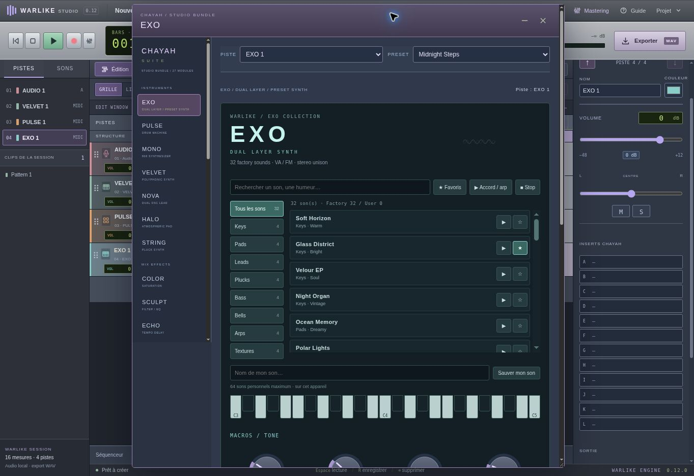

# Warlike Studio + CHAYAH Suite

Station de création musicale web de HardieBay. Version 0.14.0 : piano roll,
Channel Rack et patterns liés, prises alternatives et comping, bus, envois,
automation, analyse de loudness et exports multipistes.
FL Studio guide la composition ; Pro Tools et Logic Pro guident les workflows
d’enregistrement, de montage, de mix et de mastering.

Le studio porte désormais le nom **Warlike Studio**. Les effets conservent leur
marque CHAYAH Suite et les projets existants restent compatibles.

Une session vide et ses nouvelles pistes n’ont aucun effet inséré. Les modules
se choisissent dans les inserts ; seules les sessions démo préparent une chaîne.
Les sections numérotées ci-dessous décrivent l’historique : la section 0.14
et `docs/verification-0.14.md` décrivent les capacités et limites actuelles.

## Créer un morceau

**Bibliothèque** propose 111 emplacements/presets d’instruments (dont le sample personnel EXO Slice), 140 presets d’effets, 12 grooves,
8 percussions synthétisées et 3 sessions de 16 mesures : Nocturne Trap, Soleil Afro
et Brume R&B. Un son peut être écouté puis ajouté avec une piste et un clip éditable.
Les sessions comprennent 6 pistes d’instruments, 3 pistes vocales et des repères de
structure. Le tempo d’un groove ajouté suit la session en cours.

Ouvrir une session de départ conserve une copie dans **Projet → Session précédente**.
Les audios restent dans le stockage local. Les sessions existantes ne sont pas
remplacées automatiquement par le nouveau contenu.

## Instruments et mix

- **PULSE** : 8 percussions synthétisées, séquenceur de 1 à 32 mesures et export WAV des coups.
- **MONO** : basse 808, sub et harmoniques.
- **VELVET** : synthé polyphonique doux.
- **NOVA** : lead à deux oscillateurs.
- **HALO** : nappe à attaque et relâchement longs.
- **STRING** : synthé pincé, corps et brillance.
- **COLOR** : saturation, dosage parallèle et gain de sortie.
- **SCULPT** : filtres passe-haut et passe-bas.
- **PRISM** : EQ trois bandes, fréquences réglables, Q de la bande centrale et
  courbe de réponse calculée à partir des filtres.
- **GLUE** : compresseur, seuil, ratio, attaque, release, make-up, knee et mélange
  parallèle. La fenêtre affiche la réduction de gain réelle.
- **ECHO** : delay synchronisé au tempo et feedback.
- **AURA** : réverbération à convolution stéréo.
- **TUNE** : correction de hauteur monophonique après la prise, avec tonalité,
  gamme, vitesse, quantité, mix, comparaison et restauration de l’original.

**CHAYAH Suite** ouvre les fenêtres flottantes déplaçables et redimensionnables.
Elles restent liées à leur piste lorsque la sélection change. Les knobs acceptent
le glisser vertical, Maj pour affiner, la molette et la saisie numérique. Les racks
`.chayahfx` conservent les paramètres et les bypass. Les anciens racks reçoivent
les nouveaux paramètres avec leurs valeurs compatibles.

## Packs CHAYAH (0.7)

**Bibliothèque → Packs** regroupe deux collections, avec 5 presets par module :

| Pack | Effet | Usage |
| --- | --- | --- |
| Vocal Essentials | HUSH | Gate doux, seuil, atténuation maximale, réponse |
| Vocal Essentials | SIBIL | Atténuation dynamique des sifflantes dans une bande réglable |
| Motion & Color | EMBER | Saturation asymétrique, caractère, tonalité, mix et sortie |
| Motion & Color | ORBIT | Chorus stéréo à deux retards modulés |
| Motion & Color | SWAY | Tremolo et autopan avec vitesse en Hz |
| Motion & Color | RELAY | Delay croisé, temps au tempo, feedback et filtre |

Sélectionne la piste, choisis le preset puis **Appliquer**. **Ouvrir** affiche les
réglages complets. Les deux collections sont aussi accessibles dans le catalogue
de la Suite. HUSH et SIBIL affichent une mesure de leur atténuation. RELAY affiche
les durées de ses deux étages en millisecondes. Les racks `.chayahfx` et projets
conservent ces réglages ; les six modules sont bypassés lors d’une mise à jour.

Les fonctions prennent pour repères les familles de traitements Waves et Soundtoys.
Ce sont des effets CHAYAH originaux, sans code, assets, presets ou licence de ces
éditeurs. Aucune émulation identique de leurs algorithmes n’est revendiquée.
SIBIL est un traitement dynamique de bande, sans séparation de voix ni débruitage IA.
ORBIT est un chorus à retards modulés, sans transposition de hauteur indépendante.
HUSH réduit les passages calmes et ne supprime pas le bruit sous une voix active.

Ordre du signal : HUSH → SIBIL → COLOR → filtres/PRISM → GLUE → EMBER → ORBIT →
SWAY → RELAY → pan/fader/master ; les sends ECHO/AURA partent après RELAY.
Les répétitions croisées de RELAY peuvent inclure un bloc de latence de feedback
natif. La queue d’export est ajustée au delay, avec une limite de 20 secondes.
Les LFO de modulation sont libres et ne se synchronisent pas au transport.

## Mastering

Le bouton **Mastering** ouvre la chaîne qui traite la somme stéréo du morceau :

1. **BALANCE** : coupe-bas et EQ grave, médium, air.
2. **PRESS** : compression de bus avec réduction de gain mesurée.
3. **PEAK** : gain d’entrée, release et plafond de sortie sur les échantillons.

Presets : Départ neutre, Gentle Finish, Trap Focus, R&B Silk. Bypass global A/B,
activation par module, meters L/R, crête, RMS court, peak hold réinitialisable,
racks `.chayahmaster` et sauvegarde dans les projets. Le fader master est placé
avant la chaîne. Les mêmes traitements servent à la lecture et à l’export WAV.
Les modules de mastering sont désactivés par défaut, y compris pour les anciennes
sessions. L’ancienne compression de sécurité de sortie reste active en bypass.

PEAK associe une compression rapide et un écrêtage de sécurité au plafond choisi.
Ce plafond concerne les échantillons, pas les crêtes reconstruites (true peak).
Les meters affichent des mesures courtes et ne calculent pas des LUFS intégrés.
La réduction affichée par PEAK est celle du compresseur, hors écrêtage de sécurité.
La comparaison A/B ne compense pas automatiquement la différence de volume.

## Enregistrement, édition et sauvegarde

Import des formats audio reconnus par le navigateur, micro, piano roll, arrangement,
mixeur, inspecteur, undo/redo et sauvegarde IndexedDB. Jusqu’à 32 mesures et 64 pistes.
Un clic sélectionne un clip ; V déplace/redimensionne, P dessine, FIT ajuste la vue.
Les notes bouclent sur deux mesures et les batteries sur une mesure.

Le gain micro numérique va de 0 à +24 dB. Le niveau auto après la prise vise une
crête à −6 dBFS et conserve l’original. Un clip audio dispose de son propre gain
non destructif et d’une normalisation. Les audios redimensionnés sont recadrés
sans time-stretch. TUNE utilise du code YIN/PSOLA original dans un worker et traite
les prises isolées de moins de 3 minutes ; il ne corrige pas le micro en direct.

**Projet → Télécharger le projet** produit un `.chayah` portable avec les audios et
les réglages. Export : WAV stéréo 44,1 kHz / 16 bits. Tout l’audio est traité dans
le navigateur. Les données locales sont propres à l’adresse du site : télécharge
un projet puis ouvre-le sur la nouvelle adresse pour transférer une session.

La Suite contient 39 modules web ; ce ne sont pas des binaires VST/VST3 Windows
et elle n’héberge pas de VST tiers. TUNE et les traitements sont une implémentation
web expérimentale, sans garantie de qualité équivalente aux logiciels de référence.

## Déployer WarLike Studio sur Cloudflare Pages

Application statique sans dépendance, prête pour **Pages**. Le fichier
`wrangler.jsonc` déclare le projet `warlike-studio` et le dossier `dist/`.
Créer le projet dans le compte Cloudflare reste nécessaire : publier sur GitHub
ne crée pas automatiquement une application dans **Workers & Pages**.

Dans Cloudflare, ouvrir **Workers & Pages → Create application → Pages →
Connect to Git**, sélectionner le dépôt **Motherlode94/WarLike-Studio**, puis :

| Réglage Pages | Valeur |
| --- | --- |
| Nom du projet | `warlike-studio` |
| Branche de production | `main` |
| Framework preset | `None` |
| Répertoire racine | racine du dépôt, laisser vide |
| Build command | `npm run build` |
| Build output directory | `dist` |
| Variable de build | `NODE_VERSION=22` |

Choisir **Save and Deploy**, puis vérifier le statut de production et le lien
`.pages.dev` renvoyé par Cloudflare. Ce lien existe après la création et le
déploiement réussis ; le sous-domaine dépend de la disponibilité du nom.
Les prochains commits sur `main` sont alors déployés automatiquement.

Pour un déploiement manuel authentifié sur ce projet Pages, `npm run deploy`
vérifie l’application et lance `wrangler pages deploy` sur la branche `main`.
L’ancien `wrangler deploy` ciblait un Worker et ne créait pas de lien `.pages.dev`.

Aucun identifiant de compte ou secret Cloudflare n’est inclus dans le code.
La connexion ChatGPT de l’hébergement Sites n’est pas incluse dans l’application.
Les projets audio restent dans le navigateur : exporter un `.chayah` depuis
l’ancienne adresse et l’ouvrir sur la nouvelle pour transférer sa session.

- https://developers.cloudflare.com/pages/get-started/git-integration/
- https://developers.cloudflare.com/pages/functions/wrangler-configuration/

## Vérification locale

Node.js 22 ou plus récent :

```sh
npm test
npm run build
python -m http.server 8080
```

Studio : http://localhost:8080/dist/ ; banc de rendu audio :
http://localhost:8080/tests/content-browser.html et
http://localhost:8080/tests/packs-browser.html . Le micro nécessite HTTPS ou
localhost et l’autorisation du navigateur. Les tests de signal utilisent des sons
synthétiques sans autorisation micro. Voir `docs/verification-0.6.md` et `docs/verification-0.7.md`.

## Références DSP

- de Cheveigné & Kawahara, *YIN*, JASA (2002), DOI 10.1121/1.1458024.
- https://www.dafx.de/DAFX_Book_Page_2nd_edition/chapter6.html
- https://www.w3.org/TR/webaudio-1.1/


## 0.8 — Édition / Mix

L’interface utilise une disposition de studio inspirée des fenêtres Edit et Mix : transport argenté, compteurs verts, clips contrastés, liste des pistes et des clips, et deux inserts accessibles dans chaque en-tête. Le rack inférieur est replié au démarrage ; ses onglets l’ouvrent et sa séparation ajuste sa hauteur.

La barre d’édition propose Smart, Déplacer, Rogner, Couper et Dessin. Le mode Grille utilise un pas de 1/16, 1/8, 1/4 ou une mesure ; Libre et Alt permettent de travailler hors grille. B coupe au curseur, les flèches décalent le clip, Ctrl+C/Ctrl+V copient et collent sur une piste de même type. Ctrl+= alterne Édition et Mix.

Les coupes et rognages audio conservent la source et son décalage en secondes. Les mêmes décalages sont consommés par la lecture, la reprise au milieu d’un clip et le rendu WAV. Les patterns conservent leur phase après découpe. La console donne accès aux inserts actifs et à l’ajout d’un insert, lié à sa propre piste.

Validation : `npm test` (40 tests), `npm run build`, et `tests/editing-browser.html` pour un rendu OfflineAudioContext réel. Pour cette dernière page, la copier temporairement dans dist/_edit-qa.html, la servir dans la prévisualisation, puis la retirer avant publication. Le test compare les échantillons WAV hors raccord et transitoire des filtres, avec une tolérance de deux unités de quantification 16 bits. Des fondus de 5 ms sont ajoutés aux bords par le moteur existant.

Limites : édition monoclips, pas encore de groupes de sélection, automation de volume, comping de prises ou compensation complète de latence. Les instruments restent nos moteurs de synthèse ; les modules web ne sont pas des binaires VST3.


## 0.9 — Pistes et propriétés

- Glisser le nom ou la poignée réordonne une piste dans la liste des pistes, dans Edit ou dans Mix. Le repère jaune indique la position d’insertion. Échap ou un dépôt hors zone annule le geste. Ctrl+Z/Ctrl+Maj+Z permettent d’annuler/rétablir. Les flèches du panneau et Ctrl+Alt+↑/↓ proposent la même opération.
- Cliquer sur un nom, sur ⋯, ou effectuer un clic droit sur le nom ouvre les propriétés. Le bouton Piste de la barre d’outils affiche/masque ce panneau, qui reste accessible en console et se superpose sur écran étroit.
- VOL et PAN sont des commandes dans l’en-tête, avec contrôles flottants. Volume, panoramique, nom, couleur, mute/solo et effets sont accessibles dans le panneau. Le volume est réglable de −48 à +12 dB et sa saisie réagit immédiatement ; 0 dB restaure le gain unitaire.
- Le réordonnancement conserve les objets de piste et leurs identifiants, clips, références audio et réglages. Il ne change pas le moteur sonore ou l’ordre des processeurs. L’ordre et les volumes se conservent dans le projet enregistré. La prise micro bloque le réordonnancement pendant l’enregistrement.

Références Avid consultées pour les interactions :

- https://www.avid.com/pro-tools/user-guide/edit-window — fenêtres Edit, commandes de pistes et affichage I/O/inserts.
- https://apps.avid.com/protoolsfirsthelp/version12.3/enu/Pro%20Tools%20First%20Help/mix1.basic.54.37.html — fenêtre de sortie d’une piste : fader, panoramique, mute/solo.
- https://resources.avid.com/SupportFiles/attach/Pro_Tools/12.6/Pro_Tools_Reference_Guide.pdf — sections I/O View et Volume Indicator, extraits indexés consultés pour le fader au clic sur l’indicateur de volume. Le guide PDF complet n’a pas pu être chargé par l’outil de lecture.
- https://resources.avid.com/SupportFiles/attach/Pro_Tools/10.1/Pro_Tools_Reference_Guide.pdf — extrait indexé Track List sur le glissement des noms pour réordonner les pistes.

Il s’agit d’interactions CHAYAH implémentées à partir de ces références ; ce n’est pas une implémentation complète de Pro Tools. Les effets CHAYAH conservent leur chaîne existante. Les cinq emplacements de plugins A–E configurables à ordre arbitraire, les bus de routage utilisateur, l’automation et le comping restent à développer.


## 0.10 — Inserts choisis par l’utilisateur

Le premier démarrage sans sauvegarde, Nouvelle session, les pistes ajoutées,
les imports audio et les prises sur une nouvelle piste partent sans effet inséré.
Les instruments restent ceux explicitement choisis à la création de leur piste.
Seules les sessions démo chargées dans la bibliothèque ont une chaîne préparée.
Une sauvegarde existante conserve ses modules actifs et leurs réglages.

Chaque piste dispose de douze emplacements A–L : clic sur un emplacement vide
pour choisir un effet CHAYAH, clic sur son nom pour le régler, menu ⋯ pour
remplacer, bypasser, retirer ou échanger sa position avec un autre emplacement.
Un module bypassé garde son emplacement et ses réglages. Chaque type d’effet
peut occuper un seul emplacement par piste dans cette version. Le master possède
trois emplacements pour BALANCE, PRESS et PEAK, avec les mêmes opérations.
L’ordre des emplacements est l’ordre réel des traitements, à la lecture et dans
le WAV. L’état des emplacements est conservé dans les projets et les racks.
Les effets absents et bypassés sont contournés dans le graphe audio. Le limiteur
master automatique historique est supprimé : PEAK agit uniquement si l’utilisateur
l’insère et l’active. Le fader, le panoramique et le meter restent indépendants.

Les anciens projets sans liste d’inserts migrent leurs effets actifs dans leur
ordre historique. Les réglages des effets retirés restent mémorisés pour une
réinsertion, sans traitement tant qu’ils sont absents. Les plugins VST3 natifs
externes restent non pris en charge par cette application web.

Validation : `npm test`, `npm run check`, `npm run build`, contrôles navigateur
et rendus OfflineAudioContext décrits dans `docs/verification-0.10.md`.

## 0.11 — Composer, enregistrer et mixer

**Channel Rack** crée des canaux d’instruments et des patterns de 1 à 32 mesures.
Écrire les notes ou les pas de batterie, écouter en **PAT**, puis **Placer en
Playlist au curseur** pour construire le morceau. **SONG** lit l’arrangement.
Les clips d’un même pattern restent liés. Les grooves et les remplissages
1/8–1/4 accélèrent l’écriture de batterie ; ils restent modifiables.

Le piano roll propose dessin, sélection multiple, déplacement d’accords,
redimensionnement, duplication, grille ou placement libre, quantification,
accords, notes fantômes et vélocités. Ctrl+clic sélectionne, Ctrl+A/C/V/D
sélectionnent/copient/collent/dupliquent ; Suppr efface ; Alt+Q quantifie.
Glisser le bord droit règle la durée. Alt+molette règle une vélocité. Le clavier
MIDI et la capture de notes demandent une autorisation Web MIDI explicite.

Les propriétés de piste réunissent sortie, bus/auxiliaires, envois pré/post,
automation OFF/READ/WRITE, gel audio et playlists de prises. Le comping copie
une plage de la prise choisie sans supprimer ses sources. Les clips audio
offrent fondus, crossfade, sélection/groupes, gain et transformation de durée
ou de hauteur avec restauration de l’original. Le changement de tempo conserve
la position absolue des audios. La session peut atteindre 2048 mesures.

Douze inserts restent libres sur chaque piste ; plusieurs instances du même
effet ont leurs propres paramètres. Le master a trois modules dédiés. Un bus
PREMASTER créé par l’utilisateur permet d’utiliser les autres effets en amont.
L’automation couvre volume, panoramique, niveaux d’envoi et paramètres natifs
exposés dans son éditeur ; les réglages non automatisables ne sont pas proposés.

Les réglages audio proposent entrée, canal 1/2/stéréo, gain numérique,
monitoring à travers les inserts, conservation des prises et décalage de
compensation mesurable par bouclage. La capture PCM passe par AudioWorklet
en contexte sécurisé. Les prises sont conservées avant les effets.

**Mastering** analyse LUFS intégré, maximum court terme, sample peak et une
estimation de crête interpolée 4×. Le niveau cible s’applique uniquement sur
demande. **Exporter** prépare un lien WAV ou ZIP : mix, piste, bus ou stems,
44,1/48/96 kHz, PCM 16/24 bits ou float 32 bits, plage, queues et dither optionnel.
**Projet → Versions / restaurer** conserve douze points locaux avec leurs audios.
Télécharger le projet reste nécessaire pour une copie indépendante de l’appareil.

Limites : DAW web expérimental, sans hôte VST/AAX/AU natif. Compensation de
latence limitée aux délais connus de GLUE et EXO STRIP, time-stretch WSOLA expérimental,
crête interpolée non certifiée true-peak. Rendu en mémoire avec garde de 768 Mio.
Le matériel audio, le bouclage et le clavier MIDI n’ont pas été testés physiquement.
Voir `docs/verification-0.11.md` pour les contrôles effectués.

Références de workflow consultées :

- https://www.image-line.com/fl-studio-learning/fl-studio-online-manual/html/pianoroll.htm
- https://www.image-line.com/fl-studio-learning/fl-studio-online-manual/html/channelrack.htm
- https://www.avid.com/pro-tools/user-guide/creating-busses
- https://www.avid.com/pro-tools/user-guide/playlists
- https://www.avid.com/pro-tools/user-guide/automation
- https://www.avid.com/pro-tools/user-guide/bouncing-stems
- https://support.apple.com/guide/logicpro/welcome/mac
- https://www.itu.int/rec/R-REC-BS.1770

## 0.12 — Pack EXO



**EXO** est un nouvel instrument original à deux couches VA/FM, avec trois
oscillateurs d’unisson par couche, huit formes, transposition, mélange A/B,
filtre résonant, ADSR, modulation, largeur et espace court interne. Son
arpégiateur suit les accords du pattern : Up, Down, Up/Down ou Chord, de une à
trois octaves. Le même calcul sert à PAT, SONG et au rendu audio offline.

Ouvrir **Piste → EXO** ou **Bibliothèque → Packs → EXO**. La banque comporte
32 presets originaux : quatre par catégorie Keys, Pads, Leads, Plucks, Bass,
Bells, Arps et Textures. Recherche par nom/humeur, préécoute, favoris, clavier
et jusqu’à 64 presets personnels sont disponibles dans sa fenêtre. Les sons
personnels et favoris sont locaux ; exporter le rack pour une copie indépendante.
Les paramètres de l’instrument sont aussi conservés dans le projet .chayah.

Le pack ajoute quatre inserts, avec cinq presets chacun :

| Module | Fonction |
| --- | --- |
| EXO STRIP | Coupe-bas, EQ corps/présence/air, compresseur doux et mélange parallèle |
| EXO FOCUS | Atténuation dynamique d’une bande, seuil et réduction maximale |
| EXO AIR | Excitation harmonique parallèle dans la bande aiguë |
| EXO SPACE | Convolution stéréo originale, pré-délai, durée, amortissement et largeur |

Les inserts restent vides à la création. Choisir un effet ou appliquer son preset
est une action explicite. Les instances répétées ont des paramètres indépendants.
Les paramètres natifs adaptés sont proposés dans l’automation ; les courbes de
WaveShaper et les changements d’IR ne sont pas présentés comme automatisables.
EXO STRIP ajoute un délai connu de 6 ms, pris en compte par la compensation.

La Suite compte désormais **27 modules** : sept instruments, seize effets,
trois modules de mastering et TUNE. La banque compte **142 presets**, dont
32 sons EXO et 20 presets d’effets EXO.

Les références portent sur l’organisation d’une suite de mix, la navigation
des presets, les couches et l’arpégiateur. Aucun DSP, sample, preset, logo ou
habillage propriétaire Waves, Spectrasonics ou reFX n’a été importé. EXO est
un instrument de synthèse web, pas une banque acoustique échantillonnée ni un
chargeur de leurs expansions. Les modules ne sont pas des VST3 installables.

Références officielles consultées :

- https://www.waves.com/plugins/vocal
- https://support.spectrasonics.net/manual/Omnisphere/concepts/all.htm
- https://support.spectrasonics.net/manual/Omnisphere/arpeggiator/all.htm
- https://refx.com/nexus/manual/

Vérification : `npm test`, `npm run build` et `tests/exo-browser.html`.
Voir `docs/verification-0.12.md`.

## 0.13 — Pianos enregistrés et parcours de plugins

**Piste** crée d’abord un type de piste : Audio, Instrument ou Bus/Auxiliaire.
Le nom et le nombre de pistes se règlent dans ce dialogue. Une piste Instrument
commence sans générateur : son sélecteur **Instrument** ouvre le choix du son.
Une piste Audio sert aux prises et fichiers audio ; **Importer audio** reste une
action séparée. Un bus reçoit le routage, sans clip ni instrument.

Les sélecteurs d’instruments et d’effets sont séparés. La recherche, les catégories
et les favoris filtrent uniquement le type choisi. Cliquer sur un insert vide
ouvre les effets ; cliquer sur le nom du module ouvre sa fenêtre ; le voyant
permet un bypass direct et le menu ⋯ remplace, déplace, copie ou retire le module.
Les douze inserts sont affichés verticalement dans leur ordre de traitement.
La fenêtre de plugin montre le rack de sa piste, plutôt qu’une liste mêlant
tous les instruments et effets. Changer un instrument mélodique conserve les
notes et les inserts de la piste. Le piano roll propose également ce changement.

La collection ajoute **12 instruments échantillonnés, 48 presets et 132 MP3**
(9,7 Mo compressés) :

| Instrument | Enregistrements |
| --- | --- |
| GRAND | Piano à queue Kawai, 35 samples, deux nuances sur la majorité du clavier |
| UPRIGHT | Piano droit Yamaha, 15 samples, deux nuances |
| FM KEYS | Clavier FM TX81Z, 12 samples |
| HARP | Harpe de concert, 10 samples |
| MARIMBA | Lames de bois, 8 samples |
| VIBES | Vibraphone aux mailloches douces, 5 samples |
| KALIMBA | Kalimba / mbira kényane, 8 samples |
| STRUM | Strumstick pincé à trois cordes, 8 samples |
| VIOLIN | Violon solo à l’archet, 9 samples |
| CELLO | Ensemble de violoncelles, 7 samples |
| FLUTE | Flûte traversière, 8 samples |
| TRUMPET | Trompette, 7 samples |

La vélocité règle la dynamique ; les pianos mélangent leurs nuances enregistrées
lorsqu’elles sont disponibles à la hauteur choisie. Brillance, couleur, attaque,
relâchement, largeur, transposition et sortie sont réglables. Les sons tenus des
cordes et vents utilisent des boucles préparées. L’audio est chargé à la première
utilisation et partagé avec le rendu offline ; un échec de chargement est affiché
et n’est pas remplacé par un oscillateur. Les anciens VELVET, EXO et autres synthés
restent disponibles comme instruments distincts.

La Suite compte **39 modules**, dont 19 instruments, et **190 presets**, dont
110 sons d’instruments et 80 presets d’effets. Les nouveaux instruments
utilisent des enregistrements VCSL et VSCO 2 Community Edition sous CC0 ; leurs
sources, révisions et transformations sont dans `dist/samples/sources.json`,
avec les licences et une page de crédits accessible dans le lecteur.

La sélection est compacte : elle n’inclut pas toutes les notes enregistrées,
toutes les articulations, la résonance sympathique modélisée ou une pédale MIDI
continue. Les notes intermédiaires sont transposées à partir du sample proche.
Le moteur limite à 48 voix simultanées par contexte et borne son cache partagé.
Les samples sont normalisés et compressés, les queues raccourcies pour le web.

Reproduction des médias (outil de maintenance, Python/numpy/scipy et ffmpeg) :
`python scripts/prepare-acoustic-samples.py --plan dist/samples/sources.json --cache /tmp/warlike-sample-cache`.
Le build Cloudflare ne relance pas cette conversion : il vérifie les 132 fichiers
déjà présents dans le dépôt.

Références :

- https://www.image-line.com/fl-studio-learning/fl-studio-online-manual/html/mixer_plugin.htm
- https://www.image-line.com/fl-studio-learning/fl-studio-online-manual/html/channelrack.htm
- https://www.image-line.com/fl-studio-learning-content/fl-studio-online-manual/html/playlist_audioclip.htm
- https://apps.avid.com/proToolsFirstHelp/version12.3/enu/Pro%20Tools%20First%20Help/sess3.tracks.14.40.html
- https://resources.avid.com/SupportFiles/PT/Pro_Tools_Reference_Guide_2019.6.pdf
- https://github.com/sgossner/VCSL
- https://github.com/sgossner/VSCO-2-CE

## 0.14 — WarLike Flow, quatre nouveaux packs et démos réécrites

Composer, Enregistrer, Mixer et Masteriser présentent quatre espaces pour la même session.
Fichier et Édition donnent accès aux opérations du projet et aux actions de montage.
La clé et la gamme se choisissent dans le transport ; elles pilotent la grille du piano roll
sans transposer silencieusement les notes déjà écrites.

- Dossiers repliables et option de bus commun, sans effet ajouté.
- Channel Rack avec mute, panoramique, volume, sortie, mini piano roll et les huit voix PULSE
  programmables en pas de 16, avec sélection de la mesure.
- EXO Slice : importer jusqu’à 120 secondes, détecter les attaques, ajouter des coupes,
  jouer les pads ou un sample chromatique, reverse et création d’un pattern éditable.
- Variantes A/B/C : humaniser, aérer, décaler d’une octave ou créer une réponse.
  La version choisie devient une copie ; la source reste disponible.
- Prises affichées en lignes, audition en contexte et sélection d’une plage de comping.
- Fondus directement sur les clips : durée et courbure, avec tension liée sur les
  crossfades en puissance égale. Les outils du clip produisent des versions
  reverse, polarité inversée, retrait du continu, échange stéréo ou normalisation.
- Automation : clic pour ajouter un point, glissement pour le déplacer, zoom,
  grille, Maj pour affiner, clic droit/Suppr pour supprimer, flèches pour ajuster.
- EQ graphiques manipulables (PRISM, CIRCUIT EQ, VECTOR EQ), comparaison A/B de piste
  et référence séparée avec égalisation du niveau moyen RMS sur quatre mesures.

La Suite compte **52 modules uniques** : 20 instruments, 28 FX, les trois
modules mastering historiques et TUNE après prise. Les 28 FX sont également
disponibles dans les **12 inserts du master** (31 choix au total).
Sept packs et 251 presets sont présents. Aucun effet n’est préinséré dans une
nouvelle session, une nouvelle piste ou un import.

| Nouveau pack WarLike | Fonctions | Référence fonctionnelle étudiée |
| --- | --- | --- |
| CIRCUIT | EQ à Q proportionnel, compresseur de bus parallèle, saturation | API / Waves |
| ALTER | Doubler modulé, délai synchronisé avec ducking, filtre animé | Soundtoys |
| VECTOR | EQ six bandes, compression parallèle, limiteur de crêtes échantillons | FabFilter |
| VOX LAB | Correction monophonique live, compression deux étages, de-essing + air | Antares |

Ces traitements utilisent notre code, nos réglages et nos graphes Web Audio.
Ils ne contiennent ni le DSP ni les presets, interfaces ou marques commerciales
des fabricants étudiés. Leurs limites ne sont pas celles des produits de référence.
VOX TUNE utilise YIN et deux lecteurs granulaires avec une latence de 40 ms ;
il vise une voix isolée, dépend d’AudioWorklet/HTTPS et ne corrige pas les formants.
VECTOR LIMIT borne les échantillons ; il n’est pas un limiteur true-peak certifié.
Les compresseurs ne prétendent pas modéliser des circuits analogiques spécifiques.

Les trois démos ont des partitions, tonalités, orchestrations et arrangements différents :
Nocturne Trap (Fa♯ mineur, half-time et 808), Soleil Afro (Ré majeur, strumstick,
marimba, kalimba et percussions), Brume R&B (Do mineur, clavier FM enregistré et
accords enrichis). Les versions déjà sauvegardées sont conservées ; ouvrir la démo
depuis Projet → Sessions charge sa nouvelle composition en gardant une sauvegarde.

Le moteur ne crée plus les dix/vingt-deux processeurs de packs sur chaque piste
vide. Les voix libèrent leurs nœuds, les anciennes sessions libèrent leurs canaux
et le scheduler saute les événements expirés au retour d’un onglet en arrière-plan.

Vérifications : `npm test`, `npm run check`, `npm run build`,
`tests/demos-browser.html`, `tests/studio-packs-browser.html` et
`docs/verification-0.14.md`. Le diagnostic de compatibilité est disponible à
`/diagnostics.html` sur l’hébergement HTTPS.

Sources fonctionnelles :
- https://www.waves.com/bundles/api-collection
- https://www.soundtoys.com/product/microshift/
- https://www.soundtoys.com/product/little-alterboy/
- https://prod.fabfilter.com/products
- https://antarestech.com/documentation/auto-tune-vocal-compressor
- https://developer.mozilla.org/en-US/docs/Web/API/BaseAudioContext/audioWorklet

### Retour visuel
Le bouton **✎ Annoter** fige la vue courante : crayon, flèche, ellipse, cadre, notes numérotées, annulation et export PNG incluant les commentaires. Les captures restent sur l’appareil ; joindre le PNG à la conversation pour le transmettre. Une image peut également être importée. Capture DOM avec html-to-image 1.11.13 (MIT), source et licence dans `dist/vendor/html-to-image/`.
